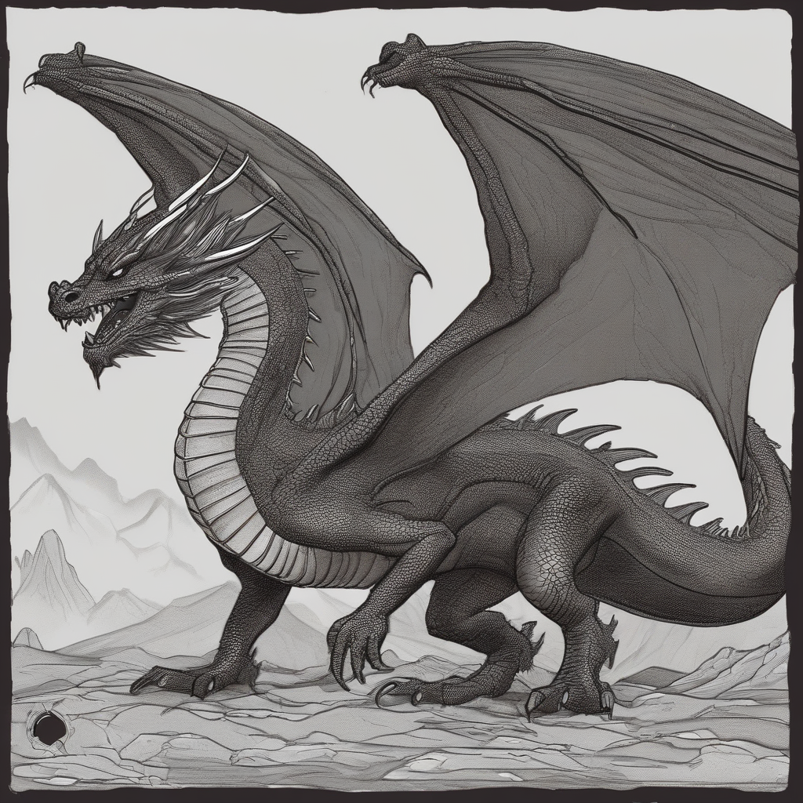
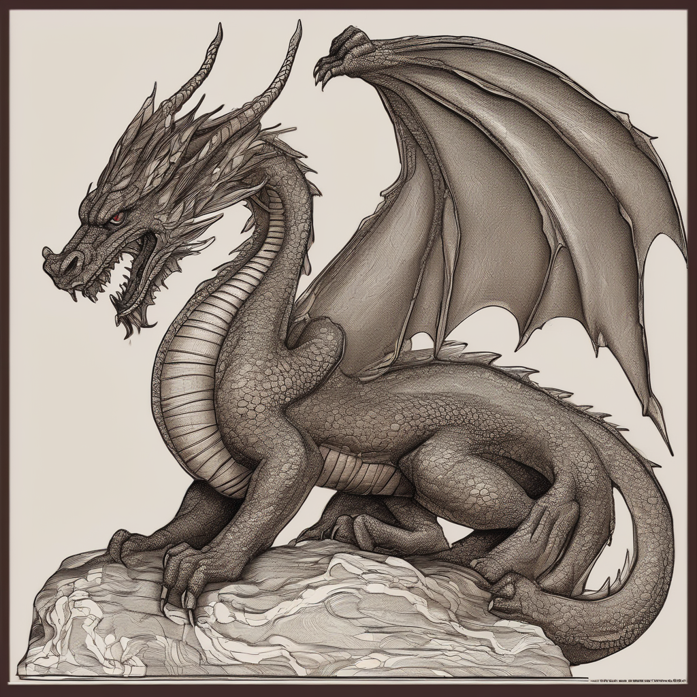
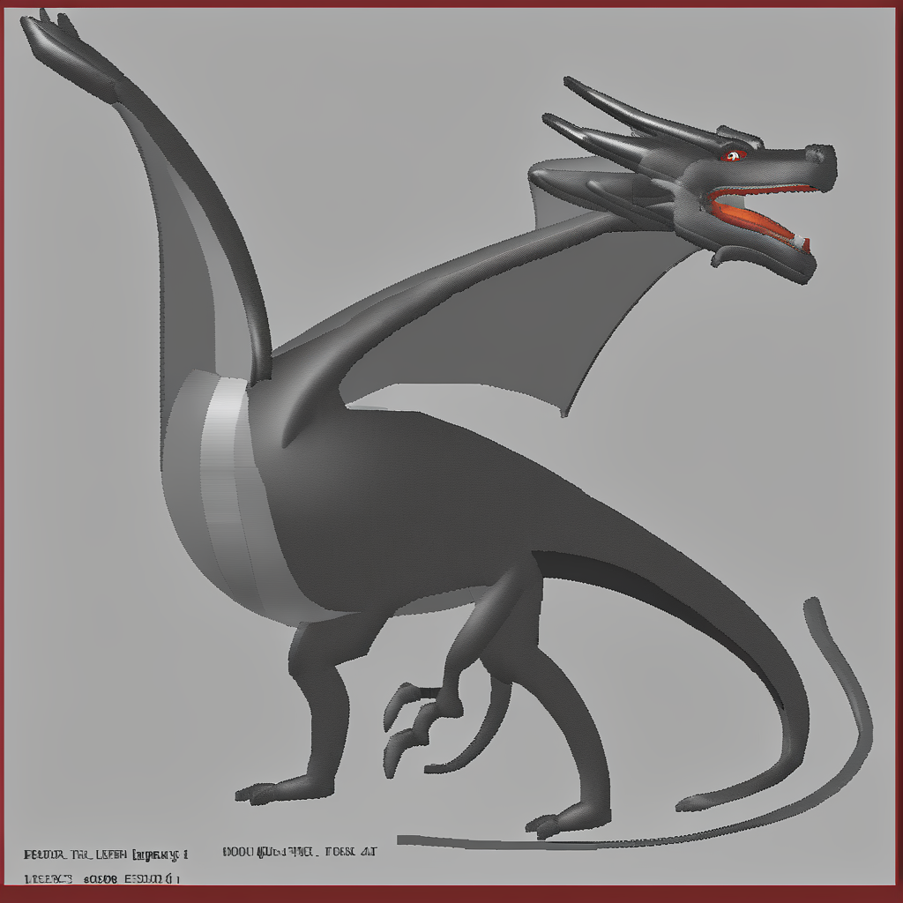

# 🎨 SDXL LoRA Fine-Tuning: "Csaba Style"

This repository demonstrates **Low-Rank Adaptation (LoRA)** fine-tuning of the **Stable Diffusion XL (SDXL 1.0 Base)** model to learn a custom, highly distinct 2D aesthetic ("Csaba Style"). 

Using a minimalist dataset of just **15 custom MS Paint illustrations** consisting strictly of red and green lines, the model was successfully taught to bypass its default photorealistic/3D tendencies and reproduce a naive, retro 2D drawing style on command.

---

## 📊 Visual Comparison & Results

The power of the trained LoRA adapter is illustrated below using the prompt `"dragon"` across different configurations:

| Preview | Image File & Prompt | Model / Adapter State | Result & Description |
| :---: | :--- | :--- | :--- |
|  | `orig_dragon.png`<br>**Prompt:** `dragon` | Base SDXL 1.0<br>*(No LoRA)* | **Standard SDXL:** Highly detailed, realistic 3D fantasy dragon on a dramatic background. |
|  | `orig_dragon_in_csaba_style.png`<br>**Prompt:** `dragon in csaba style` | Base SDXL 1.0<br>*(No LoRA)* | **Base Model Failure:** Practically unchanged from the baseline; the base model has no concept of "csaba style". |
|  | `custom_dragon.png`<br>**Prompt:** `dragon` | SDXL + LoRA Adapter | **Partial Influence:** Without the trigger keyword, the output is noticeably simpler and less complex than the baseline, showing structural influence from fine-tuning. |
|  | `custom_dragon_in_csaba_style.png`<br>**Prompt:** `dragon in csaba style` | SDXL + LoRA Adapter | **Full Activation:** Pure naive 2D red and green illustration on a neutral canvas—looking like a clever 10-year-old drew it in MS Paint! |

---

## 📁 Repository Structure

```text
.
├── csaba_paint_dataset.zip           # Dataset containing 15 red/green MS Paint PNG drawings & captions
├── image_generator.ipynb             # Baseline generation script (uses SDXL Base directly)
├── custom_image_style.ipynb          # LoRA training notebook (dataset extraction, training, testing)
├── orig_dragon.png                   # Benchmark: Base SDXL prompt="dragon"
├── orig_dragon_in_csaba_style.png    # Benchmark: Base SDXL prompt="dragon in csaba style"
├── custom_dragon.png                 # Benchmark: Fine-tuned SDXL prompt="dragon"
├── custom_dragon_in_csaba_style.png  # Benchmark: Fine-tuned SDXL prompt="dragon in csaba style"
└── README.md                         # Project documentation
```

> **Note:** The trained output weights (`pytorch_lora_weights.safetensors`) are **not** committed directly to GitHub due to file size best practices. Instead, the model is hosted on Hugging Face:
> 🔗 **[fcsaba/csaba-style-sdxl-lora on Hugging Face](https://huggingface.co/fcsaba/csaba-style-sdxl-lora)**

---

## ⚡ Quickstart: Inference without Training

Thanks to the pre-trained weights on Hugging Face, **you do not need to retrain the model**. You can load the adapter directly in Python:

```python
import torch
from diffusers import AutoPipelineForText2Image

# 1. Load SDXL Base 1.0
pipe = AutoPipelineForText2Image.from_pretrained(
    "stabilityai/stable-diffusion-xl-base-1.0", 
    torch_dtype=torch.float16
).to("cuda")

# 2. Load custom LoRA weights directly from Hugging Face Hub
pipe.load_lora_weights("fcsaba/csaba-style-sdxl-lora")

# 3. Generate image deterministically
prompt = "a dragon in csaba style, plain background"
generator = torch.Generator("cuda").manual_seed(42)

image = pipe(
    prompt=prompt,
    num_inference_steps=30,
    guidance_scale=7.5,
    cross_attention_kwargs={"scale": 1.3},  # LoRA adapter strength (optimal: 1.3)
    generator=generator
).images[0]

image.save("csaba_dragon.png")
```

---

## 🏋️‍♂️ Training Details & Technical Setup

* **Base Model:** `stabilityai/stable-diffusion-xl-base-1.0`
* **Environment:** Google Colab (**NVIDIA T4 GPU**, 16GB VRAM)
* **Dataset:** 15 hand-drawn 2D PNG images (`csaba_paint_dataset.zip`), strictly green (`#008000`) and red (`#FF0000`) line art on light backgrounds.
* **Epochs:** **50 epochs** (50 epochs proved to be the sweet spot for forcing strong 2D geometry without destabilizing the UNet).
* **Training Duration:** Approximately **40–45 minutes** on the T4 GPU.

---

## 🔬 Deep Dive & Lessons Learned (Technical Notes)

### 1. Why install `diffusers` from GitHub?
In `custom_image_style.ipynb`, we run:
```bash
!pip install -q git+[https://github.com/huggingface/diffusers.git](https://github.com/huggingface/diffusers.git)
```
**Reason:** The SDXL training script (`train_text_to_image_lora_sdxl.py`) relies on cutting-edge features, bug fixes, and memory optimizations implemented in Hugging Face's latest development branch (`main`). Using standard `pip install diffusers` (from PyPI) risks version mismatches or `ImportError` exceptions when executing the training script.

### 2. How LoRA Fine-Tuning Works
Rather than re-training all 3.5 billion parameters of SDXL (which requires enterprise GPUs and massive memory), **LoRA (Low-Rank Adaptation)** keeps the base model completely frozen. It attaches tiny, trainable decomposition matrices to the Attention layers of UNet and Text Encoders.
* **Base Model Size:** ~6.6 GB (remains untouched)
* **LoRA Adapter Size:** ~20–50 MB (`pytorch_lora_weights.safetensors`)

### 3. Loading Local vs. Remote LoRA
During training, local testing uses:
```python
pipe.load_lora_weights("/content/csaba_paint_lora/pytorch_lora_weights.safetensors")
```
Once uploaded to the Hugging Face Hub, this line can be replaced globally with:
```python
pipe.load_lora_weights("fcsaba/csaba-style-sdxl-lora")
```

### 4. Reproducibility with `manual_seed(42)`
Diffusion models start from random Gaussian noise. Passing `generator=torch.Generator("cuda").manual_seed(42)` ensures that the exact same initial noise map is constructed directly in VRAM. This guarantees **100% deterministic output**, making it possible to isolate and evaluate the effect of parameter changes (e.g., `scale` or `guidance_scale`) on identical image compositions.

### 5. Optimal Inference Hyperparameters
* **`cross_attention_kwargs={"scale": 1.3}`**: At scale `1.0`, SDXL's photorealistic prior sometimes bleeds through. Boosting the scale to `1.3` forces the model strictly into the 2D MS Paint aesthetic.
* **`num_inference_steps`: 30**
* **`guidance_scale`: 7.5**
